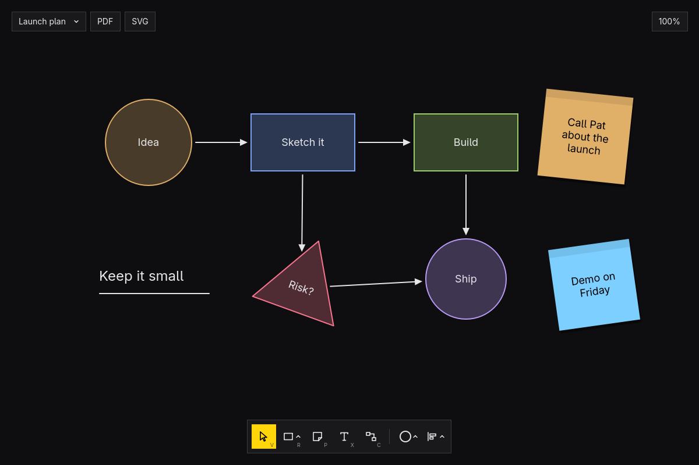

# Slate



Sketch shapes and the connections between them on an infinite canvas, for Omarchy. Rectangles, circles, triangles, post-its, lines, and text, each of which can be turned; connections that stay attached while you move things around; as many boards as you like, each saved on its own as you work.

Everything stays on this machine, in `~/.local/share/slate/boards`, one JSON file per board.

## Using it

Press a key, drag, done. Drawing a shape drops you back into selecting, so the next thing you do is move it or write on it.

- **Draw**: `R`, `O`, `T`, or `L`, then drag; the same four are in the toolbar's shapes menu. A click instead of a drag drops the shape at a comfortable size. Hold Shift for a square, a true circle, or a straight line (level, upright, or at 45°); Shift on a line's end keeps it straight too.
- **Icons**: `I` opens a menu of icons (star, check, warning, idea, person, clock and more); pick one and click or drag on the canvas. Icons move, size, turn, color, and connect like any other shape.
- **Post-its**: `P` and a click sticks one under the pointer, ready to type on.
- **Resize**: drag a corner of the selected shape, or the outline of any shape, selected or not, to change just its width or its height. The pointer turns into a resize arrow wherever that works. Hold Shift to keep the shape's proportions. With several shapes selected, the box around them resizes them all together.
- **Turn**: hold `Alt` and drag any handle of the selected shape to rotate it. It catches on every 45° and on the angle of any other shape, and shows the angle beside the pointer. Shift turns in steps of 15°, `Ctrl` turns freely, and `,` and `.` turn from the keyboard.
- **Snap**: a shape you drag catches on the sides and middles of the shapes it passes, and so does a side or corner you resize, with a guide line showing what it lined up with. Hold `Ctrl` to place or size it freely.
- **Arrange**: select several shapes and press `Alt` with an arrow to line them up on that side; `]` and `[` bring the selection to the front or send it to the back. The toolbar's arrange menu has the same.
- **Write**: double-click a shape to label it, or empty canvas for free text. Enter finishes, Shift+Enter starts a new line.
- **Connect**: hover a shape and drag from one of the dots on its sides to another shape. Let go over empty canvas and a connected copy of the shape appears there, ready to be labelled. `C` does the same from anywhere on a shape.
- **Export**: `PDF` and `SVG`, beside the board's name, save the board to your Downloads folder, drawn as it looks in the window.
- **Move around**: the mouse wheel zooms on the pointer; two fingers on a touchpad pan, and pinch zooms. Hold Space, or the middle or right button, and drag to pan.

| Key | Action |
| --- | --- |
| `R` `O` `T` `L` | Draw a rectangle, circle, triangle, or line |
| `P` | Stick a post-it |
| `I` | Place an icon |
| `X`, or `T` twice | Write text |
| `C` | Connect two shapes |
| `V`, `Esc` | Select and move |
| `Enter` | Write on the selected shape |
| `1` – `8` | Color the selection (1 is no color); the same colors are in the toolbar menu |
| `,` `.` | Rotate the selection by 15° |
| `Delete` | Delete the selection |
| `Ctrl+C`, `Ctrl+V` | Copy and paste, under the pointer |
| `Ctrl+D` | Duplicate |
| `Ctrl+A` | Select everything |
| `Ctrl+Z`, `Ctrl+Shift+Z` | Undo and redo |
| Arrows | Nudge the selection (Shift for more) |
| `Alt` + arrows | Align the selected shapes on that side |
| `Alt+H` `Alt+V` | Center the selected shapes on each other, horizontally or vertically |
| `]` `[` | Bring to the front, send to the back |
| `+` `-` `0` | Zoom in, out, and back to 100% |
| `F` | Fit everything in the window |
| `Space` | Hold and drag to pan |
| `B` | Open the boards menu at the top left |
| `Ctrl+N` | New board |
| `Ctrl+Tab` | Next board |
| `F2` | Rename this board |
| `?` | Show or hide the shortcuts |
| `Q` | Quit |

Slate follows the Omarchy theme (colors are stored as palette names, so a board changes with the theme), the window rounding, and the language picked under Setup > Language.

## Building

```bash
bin/build                                  # into build/
bin/test                                   # builds, then runs the tests offscreen
cmake --install build --prefix ~/.local    # into the app launcher
```

It needs `cmake`, a C++ compiler, and Qt 6 (`qt6-base`, `qt6-declarative`, `qt6-svg`, `qt6-wayland`), all part of Omarchy.

## License

MIT. The theme, translator, and build scaffolding come from the Omarchy apps by David Heinemeier Hansson.
